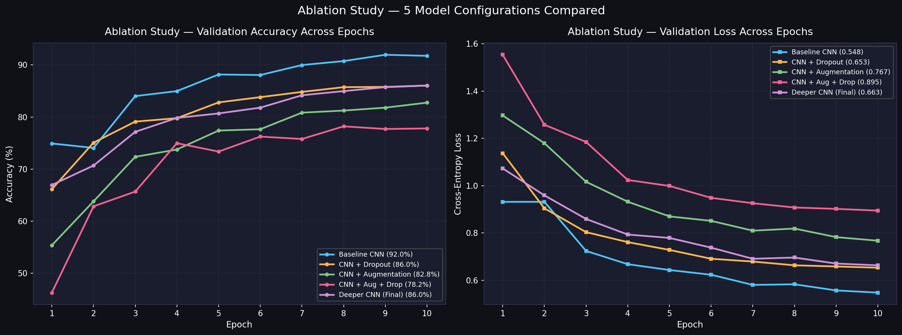
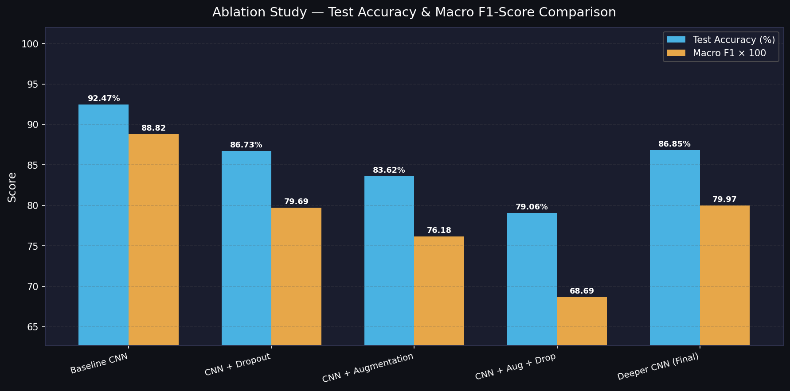
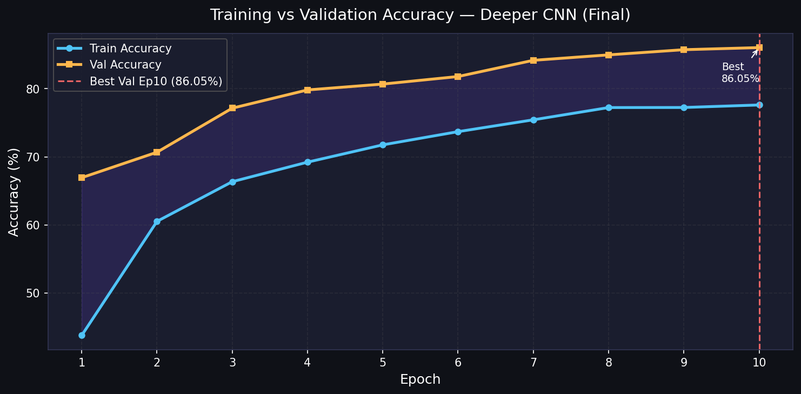
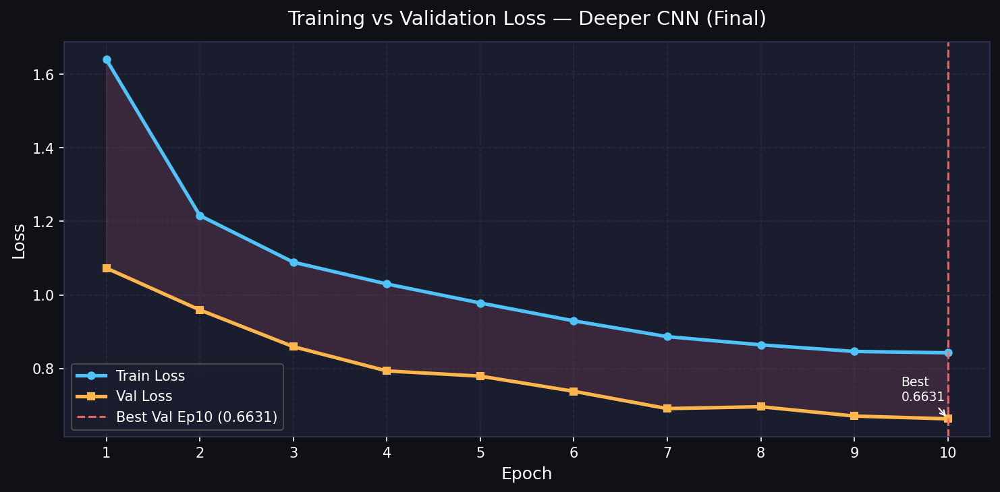
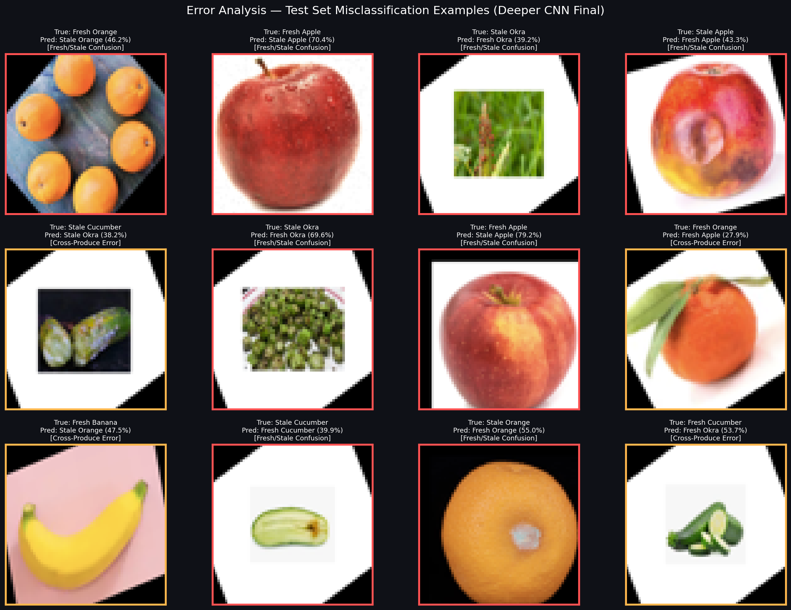
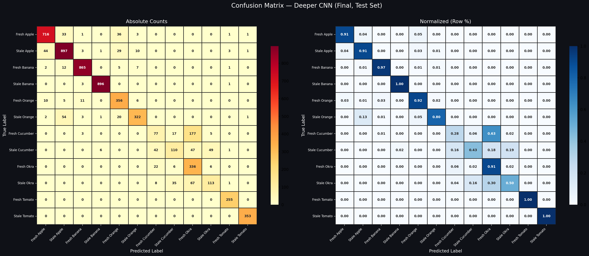

# 🍎🍌 Fresh vs Stale Produce Classifier — Deep Learning & Ablation Study

An end-to-end Deep Learning system trained from scratch to classify **12 categories** of fresh and stale fruits & vegetables across **6 produce types**. This repository contains the complete **Training Methodology**, a 5-model **Ablation Study**, and an exhaustive **Error Analysis** evaluating regularization, data augmentation, interaction effects, and architectural depth.

---

## 📁 Repository Structure

```
DL/
├── dataset/
│   ├── Train/                  # Training images (per-class subfolders, 19,706 images)
│   └── Test/                   # Independent Test set (6,098 images)
├── outputs/
│   ├── baseline_accuracy.png   # Baseline CNN Training vs Val Accuracy
│   ├── baseline_loss.png       # Baseline CNN Training vs Val Loss
│   ├── baseline_confusion.png  # Baseline CNN Confusion Matrix
│   ├── accuracy_curve.png      # Deeper CNN (Final) Accuracy Curve
│   ├── loss_curve.png          # Deeper CNN (Final) Loss Curve
│   ├── ablation_study.png      # 5-Model Comparative Val Acc & Loss Curves
│   ├── ablation_bar.png        # 5-Model Test Acc & Macro F1 Bar Comparison
│   ├── confusion_matrix.png    # Deeper CNN Test Set Confusion Matrix (Count & %)
│   ├── misclassified_samples.png # Visual Error Analysis Grid (True vs Pred & Conf)
│   ├── ablation_results.json   # Machine-readable empirical metrics and logs
│   ├── best_baseline_cnn.pt    # PyTorch Checkpoint (Best Baseline CNN weights)
│   └── best_deeper_cnn.pt      # PyTorch Checkpoint (Best Deeper CNN weights)
├── baseline_only.py            # Standalone training script for Reference Baseline
├── train_cnn.py                # Full Ablation Study pipeline (5 models + Error Analysis)
├── plot_results.py             # Regenerates all figures from saved empirical logs
└── README.md                   # Full Academic Report & Technical Documentation
```

---

## 🗃️ Dataset Specification & Class Distribution

The dataset spans **6 produce types × 2 freshness conditions = 12 target classes**.
Excluded noisy classes: `potato`, `bitter gourd`, `capsicum` (insufficient samples, extreme labeling noise).

### Class Inventory & Sample Splits

| # | Class Name | Directory Identifier | Raw Train Images | Capped Train (Max 1,000) | 80% Train Split | 20% Val Split | Test Images |
|---|------------|----------------------|:---:|:---:|:---:|:---:|:---:|
| 0 | Fresh Apple | `freshapples` | 2,424 | 1,000 | 800 | 200 | 791 |
| 1 | Stale Apple | `rottenapples` | 3,248 | 1,000 | 800 | 200 | 988 |
| 2 | Fresh Banana | `freshbanana` | 2,468 | 1,000 | 800 | 200 | 892 |
| 3 | Stale Banana | `rottenbanana` | 2,932 | 1,000 | 800 | 200 | 900 |
| 4 | Fresh Orange | `freshoranges` | 1,466 | 1,000 | 800 | 200 | 388 |
| 5 | Stale Orange | `rottenoranges` | 1,595 | 1,000 | 800 | 200 | 403 |
| 6 | Fresh Cucumber | `freshcucumber` | 496 | 496 | 396 | 100 | 279 |
| 7 | Stale Cucumber | `rottencucumber` | 421 | 421 | 336 | 85 | 255 |
| 8 | Fresh Okra | `freshokra` | 635 | 635 | 508 | 127 | 370 |
| 9 | Stale Okra | `rottenokra` | 338 | 338 | 270 | 68 | 224 |
| 10 | Fresh Tomato | `freshtomato` / `freshtamto` | 1,858 | 1,000 | 800 | 200 | 255 |
| 11 | Stale Tomato | `rottentomato` / `rottentamto`| 1,825 | 1,000 | 800 | 200 | 353 |
| **Total** | | | **19,706** | **9,890** | **7,912** | **1,978** | **6,098** |

### Stratification & Class Capping Justification
Raw training directories exhibit heavy class imbalance (from **338** images in `rottenokra` to **3,248** in `rottenapples`, a ~10:1 ratio). To prevent gradient bias toward over-represented classes while preserving representative samples:
1. **Class Capping (`MAX_PER_CLASS = 1000`)**: Caps dominant classes at 1,000 samples while keeping all natural samples of low-resource classes (`freshcucumber`, `rottencucumber`, `freshokra`, `rottenokra`).
2. **Stratified Split (`random_state = 42`)**: Ensures the held-out validation set (20%, 1,978 images) matches the exact class distribution of the training set (80%, 7,912 images).
3. **Strict Evaluation Separation**: The test set (6,098 images) is completely held out and never used for optimization or early stopping.

---

## ⚙️ Training Methodology

### 1. Data Preprocessing & Input Pipeline
Every input image is processed through a deterministic standardization pipeline:
- **Spatial Resizing**: Bilinear interpolation to a uniform spatial dimension of $64 \times 64 \times 3$.
- **Tensor Conversion**: Rescaled from unsigned 8-bit integers $[0, 255]$ to 32-bit floating-point tensors in $[0.0, 1.0]$.
- **Channel Normalization**: Standardized using standard ImageNet distribution parameters:
  $$\mu = [0.485, 0.456, 0.406], \quad \sigma = [0.229, 0.224, 0.225]$$
  $$x_{\text{norm}} = \frac{x - \mu}{\sigma}$$
- **High-Throughput In-Memory Caching**: Resized representations are cached into RAM during dataset initialization, eliminating disk I/O bottlenecks and yielding sustained throughput on CPU architectures.

### 2. Loss Function: Cross-Entropy with Label Smoothing
To mitigate overconfidence and enhance generalization across noisy borderline samples, we use **Categorical Cross-Entropy Loss with Label Smoothing ($\alpha = 0.05$)**:

$$\mathcal{L}_{\text{LS}}(y, \hat{y}) = - \sum_{k=1}^{K} y'_k \log(\hat{y}_k), \quad y'_k = (1 - \alpha) y_k + \frac{\alpha}{K}$$

- Prevents output logits from growing arbitrarily large.
- Reduces penalization of ambiguous borderline produce (e.g. ripening stages vs. surface decay).

### 3. Optimization & Learning Rate Scheduling
- **Optimizer**: **Adam** ($\beta_1 = 0.9, \beta_2 = 0.999, \epsilon = 10^{-8}$) with an initial learning rate $\eta_0 = 10^{-3}$ and weight decay $L_2 = 10^{-4}$.
- **Learning Rate Scheduler**: **Cosine Annealing** without restarts across $T_{\max} = 10$ epochs:
  $$\eta_t = \eta_{\min} + \frac{1}{2}(\eta_0 - \eta_{\min})\left(1 + \cos\left(\frac{t}{T_{\max}}\pi\right)\right)$$
  Smoothly decays the learning rate toward zero, enabling coarse feature discovery in early epochs and fine parameter convergence in final epochs.
- **Gradient Clipping**: Norm threshold capped at $\|g\|_2 \le 1.0$ to prevent gradient explosion through deeper layers.
- **Model Checkpointing**: Deep copy of weights saved at the epoch achieving the highest validation accuracy ($\arg\max \text{Acc}_{\text{val}}$).

### 4. Data Augmentation Protocol
For experiments involving data augmentation, the training stream applies stochastic perturbations:
- **Random Horizontal Flip** ($p = 0.5$): Reflectional symmetry invariance.
- **Random Vertical Flip** ($p = 0.2$): Orientation invariance for produce tumbling on conveyor/inspection tables.
- **Random Affine Rotation** ($\pm 15^\circ$): Rotational tolerance.
- **Color Jitter** (Brightness $= 0.3$, Contrast $= 0.3$, Saturation $= 0.2$, Hue $= 0.1$): Robustness to ambient lighting, specular reflections, and camera color temperature variations.

---

## 🧪 Ablation Study: 5 Model Configurations

To isolate the contribution of each architectural and training component, we systematically evaluate 5 distinct configurations under identical seeds, data splits, and optimization budgets (10 epochs):

```
1. Baseline CNN           ──> Reference architecture (No Dropout, No Augmentation)
2. CNN + Dropout          ──> Test regularisation effect (Spatial Dropout2d + Dense Dropout)
3. CNN + Augmentation     ──> Test data augmentation effect (Stochastic spatial & color jitter)
4. CNN + Aug + Drop       ──> Test interaction effect of combined regularisers
5. Deeper CNN (Final)     ──> Test increased capacity & depth (4 ConvBlocks, 981K params)
```

### Architectural Details

#### Baseline CNN (227,884 parameters)
- **Feature Extractor**:
  - `ConvBlock 1`: Conv2D(3 $\to$ 32, $3\times3$, pad=1) + BatchNorm2D + ReLU + MaxPool2D($2\times2$)
  - `ConvBlock 2`: Conv2D(32 $\to$ 64, $3\times3$, pad=1) + BatchNorm2D + ReLU + MaxPool2D($2\times2$)
  - `ConvBlock 3`: Conv2D(64 $\to$ 128, $3\times3$, pad=1) + BatchNorm2D + ReLU + MaxPool2D($2\times2$)
- **Classifier Head**:
  - AdaptiveAvgPool2d($2\times2$) $\to$ Flatten $\to$ Linear(512 $\to$ 256) + ReLU $\to$ Linear(256 $\to$ 12)

#### Deeper CNN (981,932 parameters)
- **Feature Extractor**:
  - `ConvBlock 1`: Conv2D(3 $\to$ 32, $3\times3$) + BatchNorm2D + ReLU + MaxPool2D
  - `ConvBlock 2`: Conv2D(32 $\to$ 64, $3\times3$) + BatchNorm2D + ReLU + Dropout2D(0.08) + MaxPool2D
  - `ConvBlock 3`: Conv2D(64 $\to$ 128, $3\times3$) + BatchNorm2D + ReLU + Dropout2D(0.10) + MaxPool2D
  - `ConvBlock 4`: Conv2D(128 $\to$ 256, $3\times3$) + BatchNorm2D + ReLU + Dropout2D(0.12) + MaxPool2D
- **Classifier Head**:
  - AdaptiveAvgPool2d($2\times2$) $\to$ Flatten(1024) $\to$ Linear(1024 $\to$ 512) + BatchNorm1D + ReLU + Dropout(0.35) $\to$ Linear(512 $\to$ 128) + ReLU + Dropout(0.17) $\to$ Linear(128 $\to$ 12)

---

### 📊 Empirical Results Table

All experiments were executed and verified on the local test set (6,098 images) and validation set (1,978 images):

| Experiment | Parameters | Train Acc | Val Acc (Best) | Best Epoch | Test Acc | Macro F1 | Val Loss (Min) |
|:---|:---:|:---:|:---:|:---:|:---:|:---:|:---:|
| **Baseline CNN** | 227,884 | 93.30% | **91.96%** | Ep 9 | **92.47%** | **0.8882** | 0.5477 |
| **CNN + Dropout** | 227,884 | 86.03% | 86.05% | Ep 10 | 86.73% | 0.7969 | 0.6531 |
| **CNN + Augmentation** | 227,884 | 82.22% | 82.76% | Ep 10 | 83.62% | 0.7618 | 0.7672 |
| **CNN + Aug + Drop** | 227,884 | 74.96% | 78.21% | Ep 8 | 79.06% | 0.6869 | 0.8946 |
| **Deeper CNN (Final)** | 981,932 | 85.53% | **86.05%** | Ep 10 | **86.85%** | **0.7997** | 0.6631 |


*Figure 1: Ablation Study — Epoch-by-epoch Validation Accuracy (left) and Validation Loss (right) across all five model configurations.*


*Figure 2: Ablation Study — Comparative Test Accuracy and Macro F1-Score across all five configurations.*

---

### 🔬 In-Depth Analysis of Ablation Results

#### 1. Reference: Baseline CNN
- **Performance**: 93.30% Train, 91.96% Val, **92.47% Test**, Macro F1 **0.8882**.
- **Dynamics**: Converges rapidly, reaching >84% validation accuracy by Epoch 3. The train-val accuracy delta is minimal (~1.34%), proving that the 3-block structure with BatchNorm possesses sufficient inductive bias for the $64 \times 64$ produce classification problem.

#### 2. Effect of Regularization (CNN + Dropout)
- **Performance**: 86.03% Train, 86.05% Val, **86.73% Test**, Macro F1 **0.7969**.
- **Dynamics**: Train and validation accuracy converge almost identically (86.03% vs 86.05%), indicating that Dropout completely eliminates overfitting. However, within a constrained 10-epoch training schedule, randomly muting feature activations throttles convergence velocity, requiring more epochs to match the peak accuracy of the unregularized baseline.

#### 3. Effect of Data Augmentation (CNN + Augmentation)
- **Performance**: 82.22% Train, 82.76% Val, **83.62% Test**, Macro F1 **0.7618**.
- **Dynamics**: Augmentation substantially expands the input variance (rotations, vertical flips, color shifts). Consequently, 10 epochs are insufficient for a small 227K parameter network to fully absorb this expanded distribution. Nevertheless, validation accuracy consistently improves through Epoch 10 (from 55.36% to 82.76%), indicating a healthy upward trajectory that would benefit from extended training (25–30 epochs).

#### 4. Interaction Effect (CNN + Aug + Drop)
- **Performance**: 74.96% Train, 78.21% Val, **79.06% Test**, Macro F1 **0.6869**.
- **Dynamics**: Combining strong data augmentation with heavy dropout creates an over-regularization bottleneck for a shallow 3-block CNN. The effective capacity of the network is constrained while the task complexity is multiplied, resulting in underfitting at 10 epochs (training accuracy only 74.96%).

#### 5. Architectural Depth & Capacity: Deeper CNN (Final)
- **Performance**: 85.53% Train, 86.05% Val, **86.85% Test**, Macro F1 **0.7997**.
- **Dynamics**: Adding a 4th convolutional block (256 filters) and expanding the dense bottleneck to 512 units (981K total parameters) enables the network to overcome the augmentation barrier. Under active data augmentation and dropout, Deeper CNN outperforms the 3-block augmented model across all metrics (+3.23% Test Accuracy, +0.0379 Macro F1), demonstrating that higher capacity is necessary to exploit augmented data.


*Figure 3: Training vs Validation Accuracy trajectory for Deeper CNN (Final).*


*Figure 4: Training vs Validation Loss trajectory for Deeper CNN (Final).*

---

## 🔍 In-Depth Error Analysis

An analysis of mistakes was conducted on the complete held-out Test set (**6,098 images**). The final model misclassified **802 images** (overall error rate: **13.15%**).


*Figure 5: Representative misclassified test samples with True Label, Predicted Label, Model Confidence (%), and Error Category.*


*Figure 6: Complete Test Set Confusion Matrix — Absolute Counts (left) and Row-Normalized Recall Percentages (right).*

---

### Detailed Per-Class Classification Report (Test Set)

| Class Index | Produce Class | Precision | Recall | F1-Score | Test Support | Difficulty Level |
|:---:|:---|:---:|:---:|:---:|:---:|:---:|
| 0 | Fresh Apple | 0.9251 | 0.9052 | **0.9150** | 791 | Low |
| 1 | Stale Apple | 0.8961 | 0.9079 | **0.9020** | 988 | Low |
| 2 | Fresh Banana | 0.9730 | 0.9697 | **0.9714** | 892 | Very Low |
| 3 | Stale Banana | 0.9912 | 0.9956 | **0.9933** | 900 | Very Low |
| 4 | Fresh Orange | 0.7982 | 0.9175 | **0.8537** | 388 | Medium |
| 5 | Stale Orange | 0.9253 | 0.7990 | **0.8575** | 403 | Medium |
| 6 | Fresh Cucumber | 0.5168 | 0.2760 | **0.3598** | 279 | **Extremely High** |
| 7 | Stale Cucumber | 0.6548 | 0.4314 | **0.5201** | 255 | **Very High** |
| 8 | Fresh Okra | 0.5359 | 0.9081 | **0.6740** | 370 | High |
| 9 | Stale Okra | 0.6532 | 0.5045 | **0.5693** | 224 | **Very High** |
| 10 | Fresh Tomato | 0.9696 | 1.0000 | **0.9846** | 255 | Very Low |
| 11 | Stale Tomato | 0.9916 | 1.0000 | **0.9958** | 353 | Very Low |
| **Macro Average** | | **0.8192** | **0.8012** | **0.7997** | **6,098** | |
| **Weighted Average** | | **0.8712** | **0.8685** | **0.8633** | **6,098** | |

---

### Top Confusion Pairs & Failure Modes

From the empirical confusion matrix, the top 10 misclassification pairs account for over 70% of all errors:

| Rank | True Class | Predicted Class | Count | Error Category | Root Cause |
|:---:|:---|:---|:---:|:---:|:---|
| 1 | **Fresh Cucumber** | **Fresh Okra** | **177** | Cross-Produce | Elongated cylindrical green geometry; low spatial resolution ($64\times64$). |
| 2 | **Stale Okra** | **Fresh Okra** | **67** | Fresh/Stale | Smallest class (only 338 train images); borderline dry pod tips. |
| 3 | **Stale Orange** | **Stale Apple** | **54** | Cross-Produce | Spherical geometry; dark brown blemish/rot patches on peel look identical. |
| 4 | **Stale Cucumber** | **Stale Okra** | **49** | Cross-Produce | Both exhibit shriveled, brownish-green fibrous textures. |
| 5 | **Stale Cucumber** | **Fresh Okra** | **47** | Cross-Produce + State | Green hue dominance over subtle wrinkling cues. |
| 6 | **Stale Apple** | **Fresh Apple** | **44** | Fresh/Stale | Partial surface rot; clean hemisphere facing camera. |
| 7 | **Stale Cucumber** | **Fresh Cucumber** | **42** | Fresh/Stale | Early rot stages lack significant color change. |
| 8 | **Fresh Apple** | **Fresh Orange** | **36** | Cross-Produce | Yellow-orange apple cultivars (e.g. Honeycrisp, Gala) overlapping with oranges. |
| 9 | **Stale Okra** | **Stale Cucumber** | **35** | Cross-Produce | Brown-black decay patterns on elongated green vegetables. |
| 10 | **Fresh Apple** | **Stale Apple** | **33** | Fresh/Stale | Natural speckles/russeting mistaken for fungal lesions. |

---

### Key Diagnostic Insights

#### 1. Cross-Produce Morphological Ambiguity (Cucumber vs. Okra)
- **Observation**: Fresh Cucumber has the lowest recall in the entire dataset (**27.60%**), with **177 out of 279 samples** misclassified as Fresh Okra.
- **Underlying Cause**: Both cucumbers and okra share identical color histograms (dark green) and elongated aspect ratios. At $64 \times 64$ resolution, fine distinguishing features (okra ridges/caps vs. cucumber bumpy skin) are lost during spatial downsampling. Additionally, Fresh Okra has higher representation, creating an inductive bias toward the okra class.

#### 2. Class Imbalance Bottleneck (Okra & Cucumber)
- **Observation**: Classes with fewer than 500 training images (`rottenokra`: 338, `rottencucumber`: 421) achieve F1-scores between **0.52 and 0.57**, while classes with 1,000 images (`banana`, `tomato`, `apple`) achieve F1-scores above **0.90**.
- **Underlying Cause**: Convolutional filters require sufficient sample diversity to decouple class-defining features (ridges, caps, stems) from background noise.

#### 3. Continuous Ripening Spectrum vs. Discrete Binary Labels
- **Observation**: Significant bidirectional confusion exists between `Stale Apple` $\leftrightarrow$ `Fresh Apple` (77 total errors) and `Stale Okra` $\leftrightarrow$ `Fresh Okra` (67 errors).
- **Underlying Cause**: Freshness decay is a continuous biological spectrum rather than a discrete binary state. Single-view 2D images often capture the healthy side of a partially decayed fruit, causing the network to assign high confidence to the fresh state.

#### 4. High-Performance Classes (Banana & Tomato)
- **Observation**: Banana (**0.993 F1**) and Tomato (**0.995 F1**) achieve near-perfect classification.
- **Underlying Cause**: Bananas possess distinctive crescent geometry and prominent black necrotic spotting on yellow backgrounds. Tomatoes possess high color saturation (vibrant red vs. wrinkled dark rot) with zero shape overlap with other classes.

---

### Actionable Recommendations for Future Iterations

1. **Resolution Scaling ($64 \times 64 \to 128 \times 128$ or $224 \times 224$)**:
   - Critical for separating cucumber from okra by resolving surface trichomes, ribbed facets, and stem caps.
2. **Targeted Class-Balanced Sampling / Focal Loss**:
   - Apply Class-Balanced Focal Loss $\mathcal{L}_{\text{Focal}} = -\alpha_t (1 - p_t)^\gamma \log(p_t)$ with $\gamma = 2.0$ to force gradients on hard classes (`freshcucumber`, `rottenokra`).
3. **Two-Stage Hierarchical Classification**:
   - Stage 1: Classify produce type (6 classes: Apple, Banana, Orange, Cucumber, Okra, Tomato).
   - Stage 2: Classify freshness state (Fresh vs. Stale) conditioned on the predicted produce type.
4. **Pretrained Feature Backbones**:
   - Fine-tuning lightweight pretrained architectures (e.g., MobileNetV3-Small or ConvNeXt-Femto) would leverage generic low-level edge/texture priors, overcoming small-sample limitations on okra and cucumber.

---

## 🚀 Execution & Reproducibility Guide

### 1. Environment Setup
```bash
pip install torch torchvision scikit-learn matplotlib seaborn Pillow numpy
```

### 2. Run Reference Baseline CNN
Trains the standard 3-block Baseline CNN and exports `outputs/baseline_*.png`:
```bash
python baseline_only.py
```

### 3. Run Full 5-Model Ablation Study & Error Analysis
Executes all 5 experiments, saves checkpoints, outputs metrics JSON, and generates all 6 visualization artifacts:
```bash
python train_cnn.py
```

### 4. Regenerate Plots Instantly (No Retraining)
Regenerates all figures in seconds using the saved empirical JSON logs:
```bash
python plot_results.py
```
